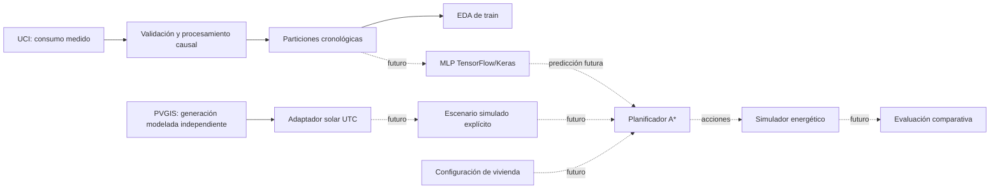

# Arquitectura y alcance de Fase 1

Este documento conserva el diseño de Fase 1. Fase 2 implementa el adaptador
predictivo, ventanas, baselines y evaluación; ver `phase2-methodology.md` para el
estado y protocolo predictivos. **La Fase 3 ya implementa simulador, A* y
evaluación causal** en `energy/`; ver [arquitectura y resultados actuales](phase3-energy.md).
El resto de este documento conserva el diseño histórico de Fase 1; sus
referencias a componentes futuros describen ese momento del proyecto.

BEKANTOR Energy conserva un núcleo Python importable con dependencias de datos
y gráficos, una CLI fina y puertos tipados independientes del framework de ML.
No hay servicios externos obligatorios en ejecución offline, telemetría,
servidores ni control de dispositivos. Esto permite sustituir archivos por
medidores reales o controladores en el futuro, mediante adaptadores explícitos.

Líneas discontinuas: especificación futura, sin lógica implementada en Fase 1.

## Archivos e interfaces

- `data/acquisition.py`: descargas HTTP acotadas, reintentos de errores
  transitorios, extracción ZIP limitada a un nombre conocido, caché con SHA-256.
- `data/uci.py`: validación y agregación horaria sin estadísticas aprendidas.
- `data/pvgis.py`: contrato v6 explícito, parámetros y fechas verificados,
  procedencia y conversión solar independiente.
- `data/splits.py`: división por posición temporal sin barajar ni eliminar huecos.
- `pipeline.py`: coordina funciones puras y salidas reproducibles; reutilizable.
- `eda.py`: tablas y gráficos locales de train por defecto, backend sin pantalla.
- `config.py`, `units.py`: supuestos físicos centralizados y unidades en nombres.
- `contracts.py`: `DemandPredictor`, `EnergySimulator`, `SearchProblem`,
  `EnergyPlanner`, `StrategyEvaluator`; DTO inmutables para predicción,
  estado, acciones, transición, insumos y plan.

Los protocolos especifican fronteras, no validación completa de DTO ni
implementaciones utilizables. El adaptador Keras futuro podrá cumplir el puerto
sin introducir TensorFlow como dependencia de adquisición o EDA. Los adapters
de hardware requerirán límites, supervisión y validación específicos de otra fase.

## Prevención de fuga temporal

1. Ordenar y validar timestamps; rechazar duplicados y fechas inválidas.
2. Reindexar minutos; usar sólo el pasado para rellenar hasta 5 minutos.
   No `bfill`, interpolación bidireccional ni promedio de toda la serie.
3. Integrar únicamente horas completas tras ese relleno. La hora `t` sólo
   está disponible después de terminar `[t,t+1h)`; no usarla antes de ese momento.
4. Dividir horas contiguas: train 70%, validation 15%, test resto. Mantener
   huecos y flags; no comprimir artificialmente el tiempo al crear ventanas.
5. En Fase 2: ajustar escaladores, imputadores aprendidos y selección de
   variables en train; elegir hiperparámetros/épocas en validation; abrir test
   sólo para evaluación final. No existe ese ajuste todavía.
6. Construir ventanas por partición con **todo su horizonte de etiquetas dentro
   de ella**. Se podrá usar contexto previo ya observado, sin etiquetas futuras
   del otro conjunto. No aceptar ventanas que salten horas desconocidas.
7. Para métricas, preferir etiquetas `is_observed_complete == True`; documentar
   cualquier uso de horas imputadas como entradas. Conservar MAE/RMSE por horizonte.

El relleno de inicio de validation/test puede usar minutos anteriores del
conjunto previo: es causal y disponible en una evaluación temporal progresiva.
No se permite rellenar train con valores procedentes de validation/test.
Las pruebas de invariancia al modificar el futuro y de orden cronológico
verifican la preparación actual; no prueban un modelo todavía inexistente.

## Integración neural con A* (diseño para fases posteriores)

La MLP producirá `demand_kwh[t]` con fecha de emisión, intervalos y `model_id`.
El planificador recibirá ese pronóstico dentro de `PlanningInputs`, junto con
solar modelada, configuración y `scenario_id`. La demanda predicha cambiará
el balance energético, la importación de red y el costo de cada transición.
Así la red altera la función de costo y potencialmente las acciones de A*.

Estado candidato: `(paso, energía_almacenada_discretizada)`. Acciones candidatas:
reposo y niveles discretos de carga/descarga; meta: finalizar el horizonte
respetando restricciones. Se definirán granularidad y límites de nodos según
el tamaño del espacio. El costo acumulará importación por tarifa menos ingreso
de exportación, con pérdidas y restricciones del simulador. No se asume todavía
que exista una solución óptima ni que sea factible en hardware real.

`f(n) = g(n) + h(n)` vincula búsqueda con optimización: `g` acumula el objetivo
económico y una heurística admisible acota el costo restante. Diseñar y comprobar
ese límite es trabajo posterior. Con ingreso por exportación puede haber costos
negativos por paso: **no asumir que h=0 es admisible**; revisar la formulación y
las garantías de A*, o restringir exportación en la demostración reducida. El
tiempo debe avanzar en cada transición, evitando ciclos de arbitraje.

La evaluación futura reproducirá demanda **observada** sobre los planes, fuera
de la búsqueda. Comparará red sola, autoconsumo convencional, A* con baseline
de demanda, A* con MLP y, sólo como referencia explícita, A* con demanda oráculo.
Todos usarán el mismo escenario, tarifas, estado inicial y restricciones.
Reportará MAE/RMSE, costo, importación, autonomía energética definida, violaciones
físicas y nodos expandidos. La comparación MLP vs baseline dentro del mismo
planificador medirá el aporte real de las predicciones, sin confundirlo con
una diferencia de algoritmo de despacho. No hay resultados de ahorro en Fase 1.

## Local y académico

`colab/` reserva la especificación de una extracción mínima de un solo notebook.
Un exportador futuro tomará funciones seleccionadas y su versión/hash del núcleo;
no se mantendrá otro proyecto independiente. El notebook resultante deberá
ejecutar desde cero en CPU con dependencias instalables y fuentes accesibles,
sin rutas locales ni archivos privados. No se crea todavía.

## Límites actuales

Procesamiento UCI en memoria, apropiado para este conjunto de alrededor de
2.1 millones de filas; no es un motor de streaming ni una plataforma industrial.
Las tarifas son simuladas, no precios regulatorios. No se sincronizan fuentes
independientes ni se promete generalización desde una sola vivienda histórica.
Los valores extremos no se eliminan automáticamente: pueden representar cargas
reales y se inspeccionan con el EDA. El muestreo de dispositivos y la seguridad
de hardware quedan fuera del alcance.
