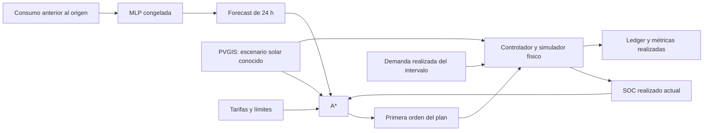

# Fase 3 — Simulador energético y planificador A*

**Implementados y verificados:** simulador con balance físico, búsqueda A*,
autoconsumo reactivo y evaluación horaria con replanificación, integrada con la
MLP existente sin reentrenar. En el ejemplo de validación de 24 horas, el costo
simulado disminuye **8,35 %**, pero la energía importada aumenta **9,24 %** y se
aprovecha menos solar. El objetivo implementado minimiza costo; no maximiza
autonomía. Es un resultado de un escenario, no ahorro real ni estimación anual.

## Arquitectura reutilizable

```text
src/bekantor_energy/energy/
  simulator.py    PhysicalSimulator + SelfConsumptionStrategy
  planner.py      BatterySearchProblem + AStarPlanner + PlannerConfig
  scenarios.py    PVGIS independiente + selección reproducible de ventana
  evaluation.py   replay con demanda realizada y replanificación horaria
  experiment.py   carga validada, puerto neural causal y artefactos
  plots.py        gráficos reproducibles, sin dashboard
```

Se reutilizan `HomeConfig`, conversiones, adquisición PVGIS, lector de
particiones y `MLPDemandPredictor`. Los DTO de `contracts.py` conservan sus
campos anteriores; incorporan campos opcionales de balance, trazabilidad y
estadísticas de búsqueda. Los módulos físicos y de búsqueda no dependen de
TensorFlow. La CLI agrega `energy-demo`; no modifica los comandos predictivos.



## Modelo físico y unidades

Para duración `dt` en horas, carga/descarga `c,d` en kW AC y energía almacenada
`E` en kWh:

```text
C_ac = c × dt
D_ac = d × dt
E_siguiente = E + eta_c × C_ac − D_ac / eta_d
perdidas = (1 − eta_c) × C_ac + (1 / eta_d − 1) × D_ac
servido = demanda − no_suministrado

solar + red_importada + D_ac = servido + C_ac + exportado + recortado
E + solar + red_importada = E_siguiente + servido + exportado + recortado + perdidas
```

Se verifican ambos balances con tolerancia numérica de 1e−9 kWh. No se redondea
el SOC real a la grilla de búsqueda. Sólo se elimina ruido de coma flotante en
los límites físicos. Se prohíben carga y descarga simultáneas, importación y
exportación simultáneas y descarga de batería para exportar o recortar energía.
Cada transición respeta capacidad, potencia y reserva. Un fallo del balance
produce una excepción; no se continúa con un estado físicamente inválido.

El simulador utiliza solar directamente para la demanda antes de cargar la
batería. Permite cargar desde red cuando está disponible y el plan lo pide.
En cortes, no importa ni exporta, prioriza servir carga y sólo carga batería
con excedente solar. La reserva es dura incluso durante el corte: una demanda
insuficientemente abastecida aparece como energía no suministrada (ENS).

`repair=False`, dentro de la búsqueda, rechaza una acción físicamente
inviable. `repair=True`, durante ejecución, limita órdenes por potencia,
espacio, reserva, desequilibrio realizado o red caída. Registra el ajuste;
no añade una descarga no solicitada para ocultar errores predictivos. Los
ajustes de órdenes no son violaciones físicas. En el autoconsumo reactivo
son habituales porque se solicita cubrir el desequilibrio y el controlador
aplica los límites de la batería.

La configuración del ejemplo conserva 3 kWp PV, batería 5 kWh, potencias AC
máximas 2,5 kW, eficiencias de carga/descarga 0,95, reserva 20 % y SOC inicial
50 %. La eficiencia de ciclo es 0,9025. PVGIS ya incorpora el rendimiento solar
0,86: **no se vuelve a multiplicar** por él.

Las tarifas de `configs/home.phase3.json` son una hipótesis en SIM/kWh:
00–06: 0,08; 07–17: 0,18; 18–21: 0,40; 22–23: 0,18.
En el replay de 24 h el vector se interpreta como perfil diario por hora del
reloj del escenario y se desplaza en cada horizonte. No son tarifas argentinas
vigentes. El suministro de red disponible es ilimitado en potencia.

## A*: formulación y garantías

- Estado: `(hora relativa, energía almacenada)`.
- Horizonte del ejemplo: 24 pasos de una hora; cada arista avanza un paso.
- Grilla: reserva a capacidad, separación 0,25 kWh. Se incluyen explícitamente
  reserva, capacidad, estado inicial exacto y objetivo terminal opcional.
- Acciones discretas: pasar a un nivel superior (cargar), inferior (descargar)
  o al mismo nivel (esperar). Las potencias se derivan de la diferencia de
  energía y las eficiencias. Se rechazan las aristas que exceden límites.
- Costo: importación predicha de esa transición × tarifa, en SIM.
- Meta: completar el horizonte respetando la reserva; puede configurarse un
  SOC terminal adicional. En la comparación se usa sólo la reserva para ambas
  estrategias. Se informan los SOC finales y no se imputa un valor terminal.
- Se deshabilita exportación remunerada en el planificador. El simulador puede
  representar exportación de solar, pero A* rechaza tarifas de venta no nulas.
  Así todos los costos del grafo son no negativos y `h=0` es una referencia
  correcta de búsqueda de costo uniforme (UCS).

La heurística por defecto, `relaxed`, es:

```text
D = suma de deficits max(demanda_predicha − solar, 0) restantes
S = suma de excedentes max(solar − demanda_predicha, 0) restantes
B = eta_d × (E_actual − E_reserva)
h = menor_tarifa_restante × max(0, D − B − eta_c × eta_d × S)
```

Es una relajación optimista: deja mover todo el excedente solar al momento
más conveniente, ignora capacidad y potencias máximas, omite costos de
reposición terminal y compra toda la energía necesaria a la menor tarifa.
Por ello no puede superar el costo restante de un plan factible en este
modelo. El valor es cero al llegar a la meta. La búsqueda reabre estados si
encuentra un menor `g`, sin depender de consistencia de la heurística.

La optimalidad se limita al **grafo discretizado con demanda predicha**,
dentro de tolerancia numérica; no implica optimalidad continua ni de la
ejecución realizada con errores. No se redondean transiciones para crear
energía. El presupuesto predeterminado es 100.000 expansiones y 10 s por
plan. Si se agota, se lanza `PlanningLimitError`; no se devuelve un plan
interrumpido afirmando que es óptimo.

El planificador de costo asume red disponible durante su horizonte. No decide
dejar carga sin abastecer para ahorrar dinero. Rechaza pronósticos con cortes
conocidos; los cortes inesperados pueden reproducirse en el simulador/replay,
con ENS y reserva. La planificación anticipada de resiliencia requiere otra
formulación y no está implementada en esta fase.

## Fuentes, correspondencia y causalidad

**Demanda:** UCI procesado, partición de validación. Se eligió antes de evaluar
costos el primer inicio a medianoche con 24 orígenes consecutivos elegibles:
**21/09/2009, 00:00–23:00**, reloj UCI conservado sin zona horaria. La selección
es un filtro retrospectivo de completitud, no de magnitud de consumo o resultado.
Train y validación se comprueban contra sus hashes. No se abrió test.

**Solar:** [PVGIS v6, JRC](https://photovoltaic-geographic-information-system.ec.europa.eu/api/),
consulta real a `power/broadband`, ERA5, Córdoba (Argentina), latitud −31,4201,
longitud −64,1888, orientación norte 0°, inclinación 30°, 3 kWp.
Período UTC: **21/09/2023 03:00 a 23/09/2023 02:00**, 48 muestras.
En `America/Argentina/Cordoba` corresponde a los días completos 21 y
22/09/2023. Consulta, parámetros, fecha de descarga y SHA-256 se conservan en
`data/raw/pvgis/cordoba-20230921.metadata.json` y el manifiesto del escenario.

La conversión es `power_W / 1000 × 1h`: aproximación rectangular de generación
modelada, no medición integrada real. El archivo de escenario conserva hora
UTC, hora de Córdoba e índice ordinal por separado. Se asigna el primer día
solar a las 24 horas UCI del ejemplo por **posición horaria**, con el segundo
día disponible para los horizontes rodantes. Son ubicaciones, viviendas, años
y condiciones distintas: **no están sincronizados** ni representan una vivienda
de Córdoba medida por UCI. Tampoco se equiparan sus días de semana.

Como hipótesis de esta primera evaluación, el perfil solar completo modelado
es conocido en cada origen: previsión solar perfecta de un escenario impuesto,
no un pronóstico meteorológico operativo. Las tarifas también son conocidas.

**MLP:** calendario + MSE convencional, semilla 2026, bundle congelado del
Experimento 1. En cada hora se pasa al puerto predictivo únicamente historia
con timestamp **estrictamente anterior al origen**, y el calendario del
horizonte. El modelo estima 24 horas sin entrenarse ni guardar pesos. El
planificador recibe estas predicciones; nunca la demanda realizada futura.

Se ejecuta sólo la primera orden, usando la demanda realizada del intervalo
en el simulador, y se vuelve a planificar con el SOC realmente alcanzado. La
bitácora `causality_audit.json` registra origen y última hora histórica enviada
a la red. `forecasts.csv` registra todos los pronósticos emitidos; `ledger.csv`
registra los flujos realizados. Los costos predichos de horizontes solapados
no se suman como si fueran costos realizados.

La referencia convencional es autoconsumo reactivo: carga con excedente solar
y descarga ante déficit actual, sin predicciones, tarifas futuras ni búsqueda.
Representa control instantáneo ideal mediante promedios horarios constantes.
Usa el mismo simulador, demanda, solar, tarifas, batería inicial y límites. Sus
órdenes son continuas; A* planifica en una grilla finita, una limitación numérica
de A* que se conserva explícita en la comparación.

## Ejemplo y resultados realizados

El [plan inicial completo de 24 horas](../experiments/phase3/validation-20261022/first_plan.csv)
incluye demanda predicha, solar, carga/descarga, energía almacenada, importación
y costo de cada transición. Su costo predicho es **1,924643 SIM**. Después se
replanifica cada hora; ese plan inicial no se confunde con la ejecución final.

| Métrica de las 24 horas realizadas | Autoconsumo reactivo | A* + MLP, replanificación |
|---|---:|---:|
| Demanda (kWh) | 23,631133 | 23,631133 |
| Solar disponible (kWh) | 17,566331 | 17,566331 |
| Costo de importación (SIM) | 2,360875 | 2,163664 |
| Energía importada (kWh) | 10,946797 | 11,958635 |
| Solar capturada en sitio AC (kWh) | 11,669863 | 10,863288 |
| Utilización solar (%) | 66,4331 | 61,8415 |
| Solar recortada (kWh) | 5,896468 | 6,703043 |
| Carga de batería desde red AC (kWh) | 0 | 2,911838 |
| Pérdidas de conversión (kWh) | 0,485526 | 0,690789 |
| Energía inicial / final de batería (kWh) | 2,5 / 1,0 | 2,5 / 1,0 |
| SOC mínimo / máximo | 20 % / 100 % | 20 % / 100 % |
| Energía no suministrada (kWh) | 0 | 0 |
| Violaciones de restricciones | 0 | 0 |
| Órdenes limitadas por el controlador | 18 | 1 |

«Utilización solar» = `(solar directa a carga + solar enviada a batería) /
solar disponible`. Incluye pérdidas posteriores y posible energía retenida;
no equivale a energía solar útil entregada a la demanda ni a autonomía.
Las dos estrategias terminan con la misma energía almacenada, por lo que en
este caso la diferencia de costo no se debe a un mayor vaciado terminal.

El costo disminuye **0,197211 SIM (8,35 %)**, pero la importación aumenta
**1,011838 kWh (9,24 %)** y la captación solar cae 4,5916 puntos porcentuales.
La planificación carga desde red barata y desplaza energía entre tarifas;
eso puede ocupar capacidad que luego podría recibir solar y añade pérdidas.
El resultado demuestra un compromiso del objetivo económico, no una mejora
simultánea en todos los indicadores ni un ahorro comercial demostrado.

Se realizaron 24 búsquedas: **6.646 nodos expandidos**, **19.011 inserciones
generadas**, **1,964 s** de búsqueda acumulada, media **81,83 ms** por plan y
máximo **115,44 ms** en este equipo. Las inserciones pueden incluir mejoras de
un mismo estado; no son estados únicos. La inferencia y preparación se
contabilizan aparte en el tiempo total de evaluación. Los tiempos son una
medición local orientativa, no una garantía de tiempo real.

El primer plan de 24 horas se verificó también con UCS: mismo costo,
**333 expansiones con la heurística relajada frente a 355 con h=0**. La reducción
de nodos es pequeña; no se afirma una aceleración general. Las heurísticas
comparten el mismo grafo y restricciones.

## Pruebas y evidencias

**87 pruebas aprobadas**: 57 regresiones sin entrenamiento neural y **30 nuevas**
de energía/integración. No se ejecutaron las pruebas históricas que entrenan
redes o evalúan test, tampoco se modificaron sus archivos.

Las pruebas nuevas incluyen:

- 1.000 transiciones aleatorias controladas, con balance AC y total, pérdidas,
  reserva, capacidad, potencias y red disponible/caída.
- Batería llena, en reserva y totalmente reservada; cero demanda, cero solar,
  tarifa cero; media hora para distinguir kW de kWh; eficiencia de ciclo.
- Rechazo de entradas inválidas, carga/descarga simultánea, descarga sin carga
  útil, descarga bajo reserva, y límites de búsqueda/grilla.
- Cortes: prioridad de demanda, ENS explícita, ausencia de importación o
  carga de batería desde una red caída. La demostración UCI principal no simula cortes.
- **30 problemas pequeños** con A* = UCS = enumeración exhaustiva; la
  heurística se comprueba contra el costo restante exacto en todos los estados
  de esos problemas. Se prueba también meta terminal e inviabilidad.
- Cambiar la demanda predicha modifica plan y costo; cambiar realizaciones
  futuras no cambia la primera decisión. El puerto neural nunca recibe esas
  realizaciones futuras ni llama a `fit`.
- Correspondencia de relojes, checksum solar, dimensionamiento, cobertura y
  ausencia de una segunda aplicación de eficiencia PVGIS.

La [verificación independiente](../experiments/phase3/validation-20261022/verification.json)
reprodujo los ledgers guardados, comprobó las mismas condiciones para ambas
estrategias, las métricas, la causalidad y el costo UCS del primer plan.
Se preservaron los hashes de **121 archivos anteriores protegidos**, incluyendo
los modelos de ambas pérdidas. El residuo máximo de balance total fue menor
que 9e−16 kWh, frente a la tolerancia 1e−9.

Gráficos inspeccionados visualmente:


- [Decisiones realizadas](../experiments/phase3/validation-20261022/plots/realized_decisions.png).
- [Comparación de costo, red y recorte](../experiments/phase3/validation-20261022/plots/comparison.png).
- [Plan inicial de 24 horas](../experiments/phase3/validation-20261022/plots/initial_24h_plan.png).
- [Métricas comparativas CSV](../experiments/phase3/validation-20261022/comparison.csv).
- [Ledger físico completo](../experiments/phase3/validation-20261022/ledger.csv).
- [Estadísticas de cada replanificación](../experiments/phase3/validation-20261022/planning.csv).

## Reproducción local en Windows

Usar el entorno y los modelos de fases anteriores, con
`requirements-ml-lock.txt` instalado para inferencia CPU. El núcleo físico y
sus pruebas sólo requieren dependencias base. Desde la raíz:

```powershell
# Descarga pública o reutilización de caché verificada, sin sobrescribir.
.\.venv\Scripts\python.exe -m bekantor_energy download-pvgis --latitude -31.4201 --longitude -64.1888 --start 2023-09-21T03:00:00 --end 2023-09-23T02:00:00 --output data/raw/pvgis/cordoba-20230921.json --processed-output data/processed/pvgis/cordoba-20230921.csv

# Las dos rutas de salida deben ser nuevas.
.\.venv\Scripts\python.exe -u -m bekantor_energy energy-demo --run-dir experiments/phase3/repeat-01 --scenario-dir data/simulated/phase3/repeat-01
.\.venv\Scripts\python.exe scripts/verify_energy_run.py --run-dir experiments/phase3/repeat-01
```

Se pueden pasar `--home-config`, `--planner-config`, `--model-bundle` y
`--solar-raw`. La demostración exige horizonte horario de 24 h, red sin cortes
planificados, exportación cero, la misma reserva terminal para las dos
estrategias y potencia/eficiencia PVGIS coherentes con la vivienda. No redimensiona
ni reinterpreta en silencio archivos solares descargados para otro sistema.

Para las 87 pruebas, sin reentrenar redes ni abrir test:

```powershell
New-Item -ItemType Directory -Force -Path experiments/tmp | Out-Null
$env:TEMP = Join-Path (Get-Location) 'experiments/tmp'
$env:TMP = $env:TEMP
.\.venv\Scripts\python.exe -c "import unittest; loader=unittest.TestLoader(); names=('test_acquisition.py','test_core.py','test_data.py','test_pipeline.py','test_forecasting.py','test_calendar.py','test_weighted.py','test_energy*.py'); suite=unittest.TestSuite(loader.discover('tests',pattern=n) for n in names); result=unittest.TextTestRunner(verbosity=2).run(suite); raise SystemExit(not result.wasSuccessful())"
```

Los datos solares fuente se guardan en `data/raw/pvgis`, el perfil derivado en
`data/processed/pvgis`, el escenario en `data/simulated/phase3` y los resultados
en `experiments/phase3`. Los archivos grandes y artefactos generados siguen
ignorados por Git. Código, configuración y documentación son versionables.

## Límites y próximos pasos para comparar los dos modelos

Es un modelo de energía horaria, sin electrónica AC, picos subhorarios,
degradación, temperatura, autodescarga, potencia de conexión, costos de
inversión ni operación de hardware. Se abstrae conversión solar mediante
PVGIS; las eficiencias de batería son constantes. No controla dispositivos.

Se evaluó un único episodio y una semilla MSE predefinida. La comparación
MPC vs reactivo mezcla información predictiva y política de control; **no
demuestra por sí sola el valor marginal de la red neuronal** frente a otros
predictores dentro del mismo A*. No se ajustaron parámetros con test, ni se
extrapolaron ahorros, autonomía o resultados regulatorios.

Para la futura comparación de las dos pérdidas, sin ejecutarla ahora:

1. Fijar episodios completos comunes de validación y los perfiles solares,
   tarifas, batería, grilla y política terminal antes de observar resultados.
2. Comparar MSE y ponderada con semillas pareadas 2026/2027/2028, el mismo
   A* y la misma demanda realizada, reiniciando ambas con el mismo SOC por episodio.
3. Informar costo, red, utilización solar, SOC final, ENS, ajustes y búsqueda;
   el menor RMSE de picos no garantiza menor costo energético.
4. Añadir persistencia como entrada del **mismo** A* para aislar el aporte de
   la predicción neural, manteniendo el reactivo como referencia operativa.
5. Evaluar dispersión por episodios y sensibilidad a errores solares/cortes,
   sin usar test para seleccionar reglas o escenarios favorables.

La interfaz `--model-bundle` admite el otro modelo y conserva sus pesos, pero
en esta fase sólo se ejecutó la demostración con MSE convencional. No se
implementó dashboard, notebook Colab, ni Fase 4. No hubo commits ni push.
