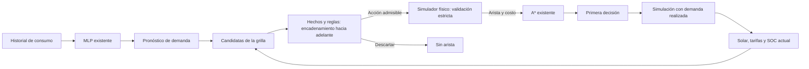

# Fase 5.1 — Razonamiento lógico en la planificación energética

## Agente y flujo

El agente combina tres componentes existentes o nuevos: la MLP TensorFlow/Keras
produce una predicción causal de demanda de 24 horas; el módulo lógico evalúa
acciones candidatas mediante hechos y reglas; A* optimiza sobre las transiciones
admisibles. La primera acción se ejecuta en el simulador físico con demanda
realizada y luego se vuelve a planificar desde el estado alcanzado. Las acciones
son **simuladas y no operan hardware real**.



`BatterySearchProblem.physical_successors` construye cada candidata y consulta
`evaluate_action` antes de llamar al simulador. Si se infiere
`discard_from_search`, la candidata no llega a A*. Si se acepta, el simulador
vuelve a verificarla con `repair=False` y conserva su balance, estado y costo.
La MLP, su entrenamiento, el simulador, la función objetivo, la heurística y el
bucle A* no se modificaron. Tampoco se alteraron resultados históricos.

## Base de conocimiento e inferencia

`logic.py` representa cada regla como nombre, conjunto explícito de premisas,
conclusión y explicación. `action_facts` convierte estado, acción y entorno en
hechos. Usa las unidades reales: potencias AC en kW, energía solicitada en kWh
tras multiplicar por `step_hours`, energía almacenada en kWh, eficiencias y
reserva. Comparaciones de límites usan `EPS = 1e-9` del simulador. Los hechos
incluyen `reserve_would_be_breached`, `capacity_would_be_exceeded`,
`charge_power_exceeded`, `discharge_power_exceeded`,
`discharge_exceeds_deficit` y `charge_exceeds_solar_surplus` sin red.

| Regla | Condición | Conclusión |
|---|---|---|
| R1 | Descarga solicitada y reserva que se superaría | Restricción energética violada |
| R2 | Carga solicitada y capacidad que se superaría | Restricción energética violada |
| R3c/R3d | Potencia de carga/descarga excedida | Restricción de potencia violada |
| R4 | Carga y descarga simultáneas | Restricción de operación violada |
| R5 | Descarga mayor que déficit de demanda | Restricción energética violada |
| R6 | Sin red y carga mayor que excedente solar | Restricción energética violada |
| R7e/R7p/R7o | Alguna restricción violada | Acción prohibida |
| R8 | Acción prohibida | Descartar de A* |

`forward_chain` aplica reglas repetidamente hasta no derivar hechos nuevos.
Devuelve hechos iniciales, hechos inferidos y, para cada regla activada, las
premisas que la sustentaron. La cadena R3c → R7p → R8 es una inferencia real de
tres pasos. La conclusión de descarte tiene prioridad ante un eventual hecho
contradictorio de permiso. No se usa una penalización de costo: la regla elimina
la arista, por lo que los costos no negativos y la admisibilidad de la heurística
se preservan sobre el mismo grafo físico.

Los hechos de límites repiten sólo los cálculos necesarios para explicar el
rechazo; **el simulador físico sigue siendo la fuente de verdad**. La aceptación
lógica nunca evita la validación estricta del simulador. El planificador actual
supone red disponible; el módulo también puede explicar una carga inviable sin
red, pero no incorpora planificación de cortes anunciados.

## Demostración reproducible en CPU

Desde la raíz del repositorio, con el entorno local instalado:

```powershell
.\.venv\Scripts\python.exe scripts/demo_energy_logic.py
```

El ejemplo sintético usa batería de 2 kWh, estado inicial de 0,5 kWh (SOC 25 %),
reserva 0, potencias máximas de 1 kW, dos horas y tarifas simuladas 0,10 y 1,00.
En la primera hora, descargar 0,5 kW se rechaza por R5 → R7e → R8 porque la
demanda es 0; cargar 1,5 kW se rechaza por R3c → R7p → R8; esperar y cargas de
0,5 o 1 kW son admisibles. A* elige cargar 0,5 kW, descargar 1 kW en la segunda
hora, con costo previsto 0,05 unidades simuladas. El script muestra para cada
candidata hechos conocidos, hechos nuevos, reglas activadas y sus explicaciones.

## Validación y límites

Ejecutar:

```powershell
.\.venv\Scripts\python.exe -m unittest discover -s tests -p test_energy_logic.py -v
.\.venv\Scripts\python.exe -m unittest discover -s tests -p 'test_energy*.py' -v
```

Tecnologías: Python 3.11+, `dataclasses`, `unittest`, simulador y A* existentes;
la MLP existente usa TensorFlow/Keras. El motor de reglas no añade dependencias.

Las pruebas del módulo comprueban reglas, encadenamiento, prioridad de rechazo,
límites y reproducibilidad. Comparan 1.000 acciones aleatorias con el simulador
estricto y, en 20 escenarios sintéticos, las aristas y los planes con una copia
de referencia del generador anterior. Esas comparaciones comprueban que el
filtro no elimine acciones físicamente válidas ni cambie planes en estos casos;
no constituyen una prueba formal para todos los números de coma flotante.
Resultado local: 5/5 pruebas lógicas y 66/66 pruebas de energía pasaron.
La optimalidad A* sigue limitada a la grilla y al pronóstico, no a la ejecución
realizada. No se abrió el test histórico reservado ni se modificaron modelos
persistidos. Al intentar la suite completa, comenzaron pruebas que ajustan MLP
con datos de prueba; se interrumpió al detectarlo. No se ejecutaron experimentos
históricos ni se guardaron modelos desde esas pruebas.
